<p align="center">
  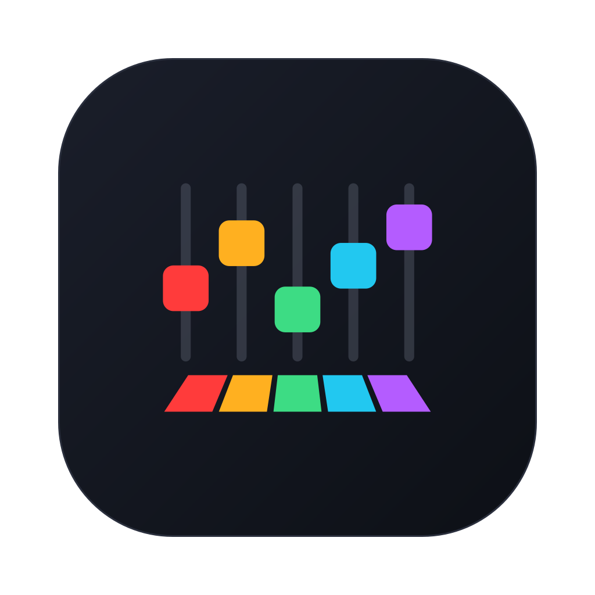
</p>

<h1 align="center">Link-Suite</h1>

<p align="center"><b>Der Launcher der Link-Suite</b></p>

<p align="center">
  <b>Kostenlose Programme für Veranstaltungstechnik – alle in einem Fenster.</b><br>
  Aus GitHub installieren und aktualisieren, starten, und sehen, wer sonst im Show-Netz ist.
</p>

<p align="center">
  <a href="#herunterladen-und-installieren"></a>
</p>

<p align="center">
  <a href="https://github.com/skyplayser/Link-Suite/releases"></a>
  
  
  <!-- WINDOWS-STAND (Badge). Aktiv: Fassung A. Zum Umschalten Zeile A löschen und Zeile B aus dem Kommentar holen. -->
  
  <!-- B:  -->
  
  <a href="LICENSE"></a>
</p>

<p align="center">
  <a href="https://skyplayser.github.io/Link-Suite/de/">Website</a> &nbsp;·&nbsp;
  <a href="#herunterladen-und-installieren">Download</a> &nbsp;·&nbsp;
  <a href="#schnellstart">Schnellstart</a> &nbsp;·&nbsp;
  <a href="#die-programme-der-suite">Die Programme</a> &nbsp;·&nbsp;
  <a href="#für-entwickler">Für Entwickler</a> &nbsp;·&nbsp;
  <a href="https://discord.gg/N6DMca4Bjk">Discord</a> &nbsp;·&nbsp;
  <a href="README.md">English</a>
</p>

<p align="center">
  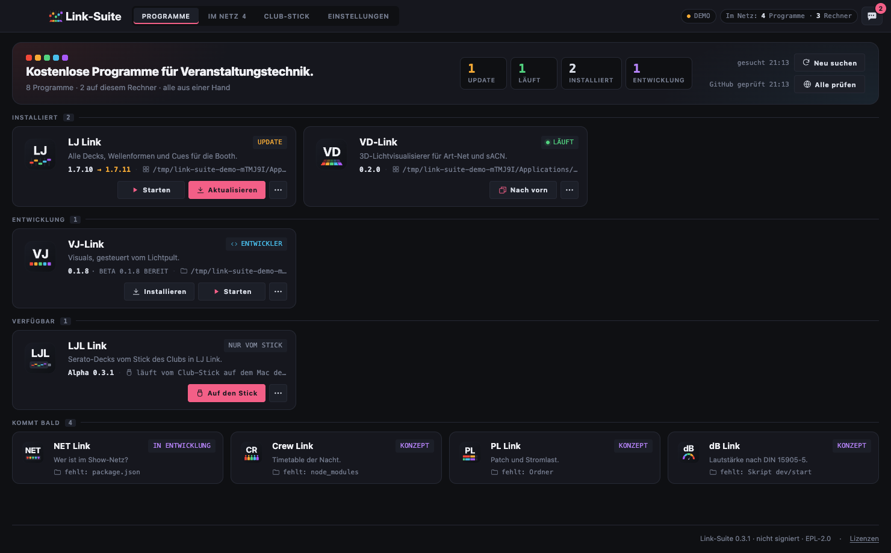
  <br><sub>Echter Screenshot von Link-Suite 0.3.2 im Demo-Modus: erfundene Ordner, Versionen und Personen.</sub>
</p>

Die Link-Suite ist eine Familie kostenloser Programme für Veranstaltungstechnik: heute
[LJ Link](https://github.com/skyplayser/LJ-Link), [LJL Link](https://github.com/skyplayser/LJL-Link),
[VJ-Link](https://github.com/skyplayser/VJ-LINK) und VD-Link, bald NET Link, Crew Link, PL Link und dB Link.
**Link-Suite** ist der Launcher, der sie zusammenhält. Er zeigt alle Programme der Suite in Gruppen, installiert und
aktualisiert sie direkt aus ihren GitHub-Releases, startet die auf diesem Rechner und listet die Suite-Programme, die er im
Show-Netz hört. Dazu bringt er den Suite-Chat mit **EMERGENCY** mit. So hat die Booth den Chat, auch wenn gerade kein
anderes Suite-Programm offen ist.

Über Link-Suite bekommst du die Suite: Die Websites der Programme bieten Link-Suite zum Download an. Link-Suite holt die
Programme aus GitHub und prüft jede Datei mit SHA-256. Die Einzel-Downloads bleiben in den GitHub-Releases der Programme.
Alle Programme der Suite haben jetzt dieselbe Startanimation und einen Hinweis auf Link-Suite.

Link-Suite hört zu, wie alle Programme der Suite. Es steuert kein Gerät und kein anderes Programm im Netz. Ins Internet geht
es nur zu GitHub: um nach neuen Versionen zu fragen und die zu laden, die du auswählst. Keine Telemetrie, kein eigener
Server, kein Konto.

> [!WARNING]
> **Das ist die Alpha 0.3.2.** Für macOS sagt die QA: release-fertig. Ein echtes
> Programm ließ sich installieren und zweimal hintereinander aktualisieren. Manches ist nur im Code oder in einem
> Entwickler-Build geprüft (siehe [Was geprüft ist](#was-geprüft-ist)).
> <!-- WINDOWS-STAND (Warnung). Aktiv: Fassung A. Zum Umschalten Satz A löschen und Satz B aus dem Kommentar holen. -->
> Die Windows-Version ist eine **Alpha und ungetestet**.
> <!-- B: Die Windows-Version ist auf Windows 11 getestet. -->
> Link-Suite ist nicht bei Apple oder Microsoft signiert. Deshalb warnen macOS und Windows einmal beim ersten Start
> ([so geht es weiter](#erster-start-die-warnung-überspringen)).

**Teil der [Link-Suite](#die-programme-der-suite)** – LJ Link · LJL Link · VJ-Link · VD-Link · NET Link · Crew Link · PL Link · dB Link

## Highlights

<table>
<tr>
<td width="50%" valign="top">

**🧭 Alle Programme auf einen Blick**<br>
Oben die Kennzahlen, auf die es ankommt – Updates, läuft, installiert, Entwicklung –, darunter die Programme in Gruppen:
*Installiert*, *Entwicklung*, *Verfügbar* und *Kommt bald*. Jede Karte hat genau eine Pille für ihren Zustand. So siehst du
sofort, was dich braucht.

</td>
<td width="50%" valign="top">

**⬇️ Aus GitHub installieren und aktualisieren**<br>
LJ Link und VJ-Link kommen mit einem Klick direkt aus ihren GitHub-Releases. Jede Datei wird mit SHA-256 gegen die Prüfsumme
von GitHub geprüft. Aktualisieren klappt auch mehrmals hintereinander, und ein hängender Download bricht sauber ab, statt
ewig zu warten. Link-Suite aktualisiert sich selbst genauso.

</td>
</tr>
<tr>
<td valign="top">

**🔌 LJL Link für den Club-Stick**<br>
LJL Link läuft vom USB-Stick des Clubs. *Auf den Stick* legt die geprüfte App in einen Ordner oder direkt auf den Stick,
mit einer kurzen Anleitung. Die `club.json` des Clubs kommt weiter von Hand daneben.

</td>
<td valign="top">

**✨ Startanimation**<br>
Die Startanimation der Suite, jetzt mit eigenem Ende: Die Programm-Icons fliegen in ihre Karten. Höchstens etwa
2 Sekunden, mit Taste oder Klick überspringen, ruhig bei „Bewegung reduzieren“, und abschaltbar.

</td>
</tr>
<tr>
<td valign="top">

**🍎 Zuhause auf dem Mac**<br>
Fenster ohne Titelleiste, Menüs mit Tastenkürzeln, ein Über-Fenster, Fortschritt und Zahl der Updates am Dock-Symbol, stille
Mitteilungen, ein Menüleisten-Symbol, eine Willkommen-Karte beim ersten Start und ein ordentliches DMG-Fenster.

</td>
<td valign="top">

**🪟 Windows ohne Admin-Rechte**<br>
Der Windows-Installer installiert Link-Suite nur für deinen Benutzer, auf Deutsch oder Englisch, und braucht keine
Administratorrechte.

</td>
</tr>
<tr>
<td valign="top">

**▶️ Installierte Programme starten**<br>
Link-Suite findet LJ Link, VJ-Link und VD-Link (auch unter alten App-Namen) und startet sie mit einem Klick. Läuft ein
Programm schon, holt der Knopf es nach vorn.

</td>
<td valign="top">

**🛠️ Entwickleransicht, nur wenn du sie brauchst**<br>
Neue Suite-Programme startest du als Entwicklerprojekt direkt aus ihrem Ordner, mit Log-Leiste und *Stoppen*. Diese Ansicht
erscheint erst, wenn du Entwicklerordner einträgst. Ohne sie zeigt Link-Suite keine npm-Befehle und keine Entwickler-Pillen.

</td>
</tr>
<tr>
<td valign="top">

**💬 Suite-Chat mit EMERGENCY**<br>
Derselbe Chatraum wie bei LJ Link, LJL Link und VJ-Link, ohne Server. Der Knopf **EMERGENCY** öffnet bei allen ein Popup.
Auf Wunsch läuft Link-Suite in der Menüleiste weiter, dann bleibt die Booth auch bei geschlossenem Fenster im Chat (ab Werk aus).

</td>
<td valign="top">

**📡 IM NETZ**<br>
Welches Suite-Programm auf welchem Rechner läuft, an welchem Platz, in welcher Version – nach Rechnern gruppiert, mit
„weg seit“ für Programme, die beendet sind. Läuft irgendwo eine ältere Version, sagt Link-Suite es. Fremde Rechner fasst es nie an.

</td>
</tr>
<tr>
<td valign="top">

**✋ Fragt, bevor es etwas ändert**<br>
Ohne deinen Klick wird nichts installiert. Link-Suite fasst Projektordner nicht an: kein `npm install`, kein Build von selbst.

</td>
<td valign="top">

**⚙️ Einstellungen für die ganze Suite**<br>
Sprache, Tag oder Nacht, dein Name und Platz im Chat und die Startanimation – einmal einstellen, gespeichert in
`suite.json`. **Deutsch und Englisch**, Tag- und Nachtmodus.

</td>
</tr>
</table>

<table>
  <tr>
    <td width="50%">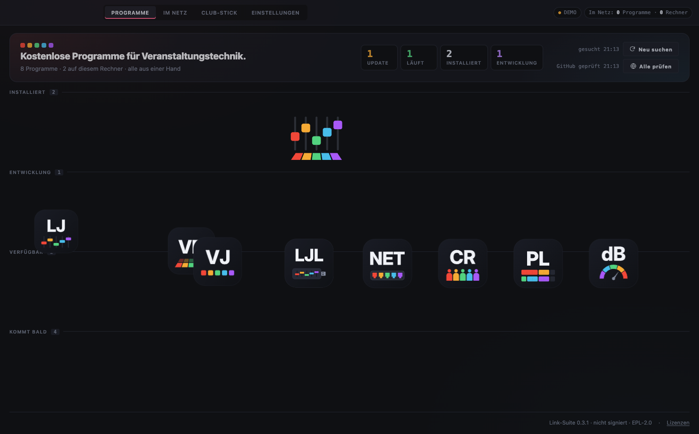<br><sub><b>Startanimation:</b> Die Icons fliegen in ihre Karten (Standbild bei 1,2 s).</sub></td>
    <td width="50%">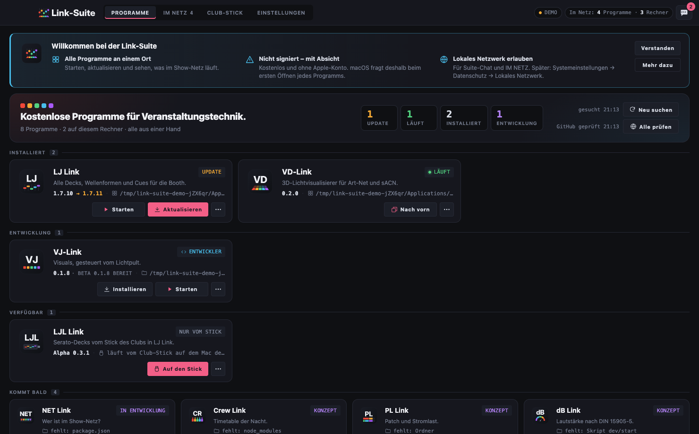<br><sub><b>Willkommen</b> beim ersten Start.</sub></td>
  </tr>
  <tr>
    <td>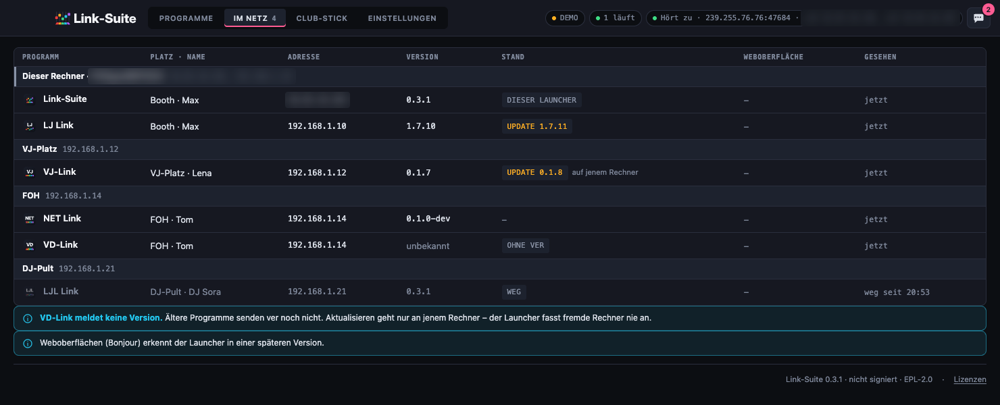<br><sub><b>IM NETZ.</b> Name und Adressen dieses Rechners sind unkenntlich gemacht.</sub></td>
    <td>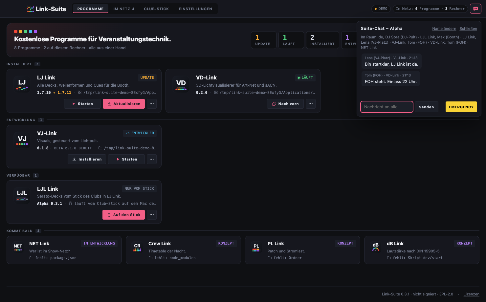<br><sub><b>Suite-Chat</b> mit EMERGENCY.</sub></td>
  </tr>
  <tr>
    <td>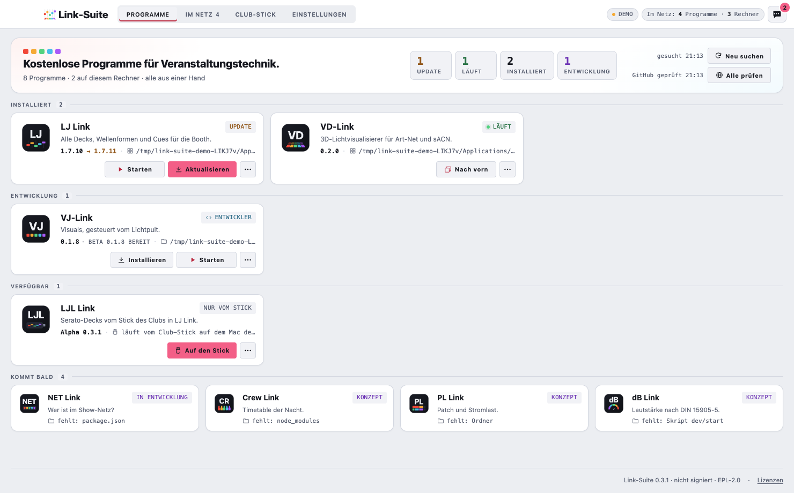<br><sub><b>Tagmodus</b> für helle Räume.</sub></td>
    <td>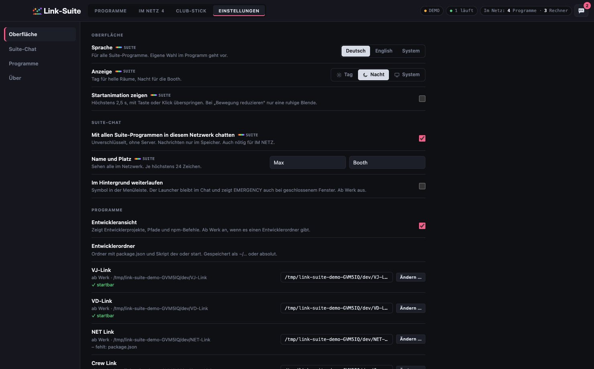<br><sub><b>Einstellungen</b> für alle Suite-Programme.</sub></td>
  </tr>
</table>
<sub>Alle Screenshots: Link-Suite 0.3.2 im Demo-Modus, mit erfundenen Ordnern, Versionen und Personen.</sub>

## Die Programme der Suite

| Programm | Was es macht | Stand | Über Link-Suite | Links |
|---|---|---|---|---|
| 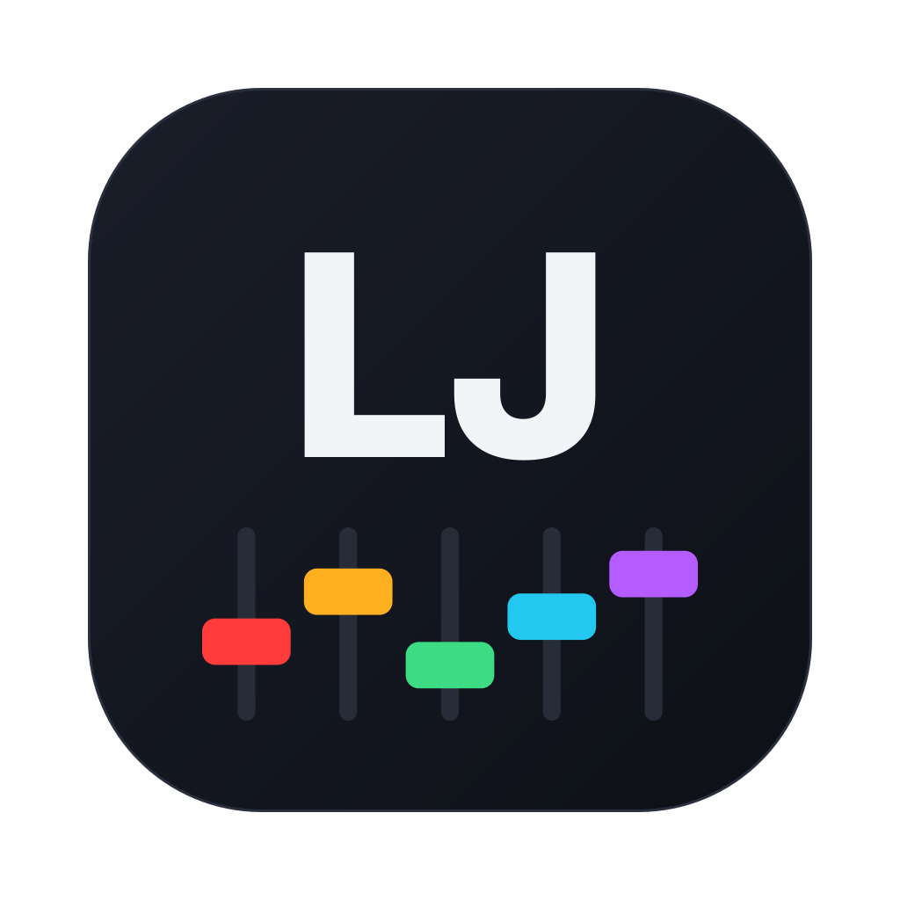 **LJ Link** | Zeigt dem Lichtjockey jedes Deck, jede Waveform und jeden Cue von Pioneer- und Denon-Geräten und schickt das Tempo ans Lichtpult | veröffentlicht, macOS und Windows | installieren und aktualisieren | [GitHub](https://github.com/skyplayser/LJ-Link) · [Website](https://skyplayser.github.io/LJ-Link/) |
| 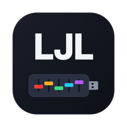 **LJL Link** | Bringt die Serato-Decks vom Mac des DJs in LJ Link, direkt vom USB-Stick des Clubs | Alpha, macOS | in einen Ordner oder auf den Stick | [GitHub](https://github.com/skyplayser/LJL-Link) · [Website](https://skyplayser.github.io/LJL-Link/) |
|  **VJ-Link** | Live-Visuals, gesteuert vom Lichtpult, im Takt der Musik | Beta, macOS und Windows | installieren und aktualisieren | [GitHub](https://github.com/skyplayser/VJ-LINK) · [Website](https://skyplayser.github.io/VJ-LINK/) |
| 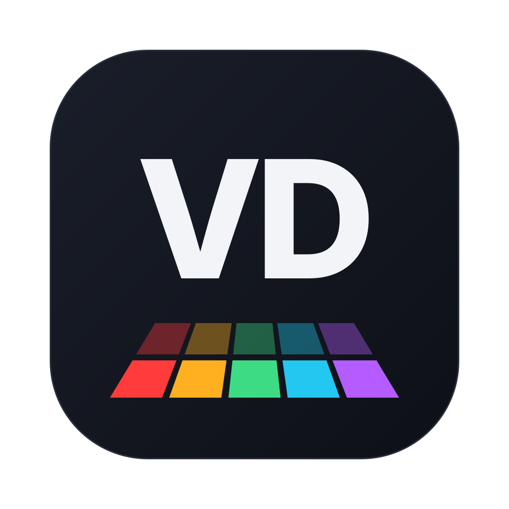 **VD-Link** | 3D-Lichtvisualisierer für Art-Net und sACN: die Show sehen, bevor sie hängt | Beta | bald verfügbar | – |
| 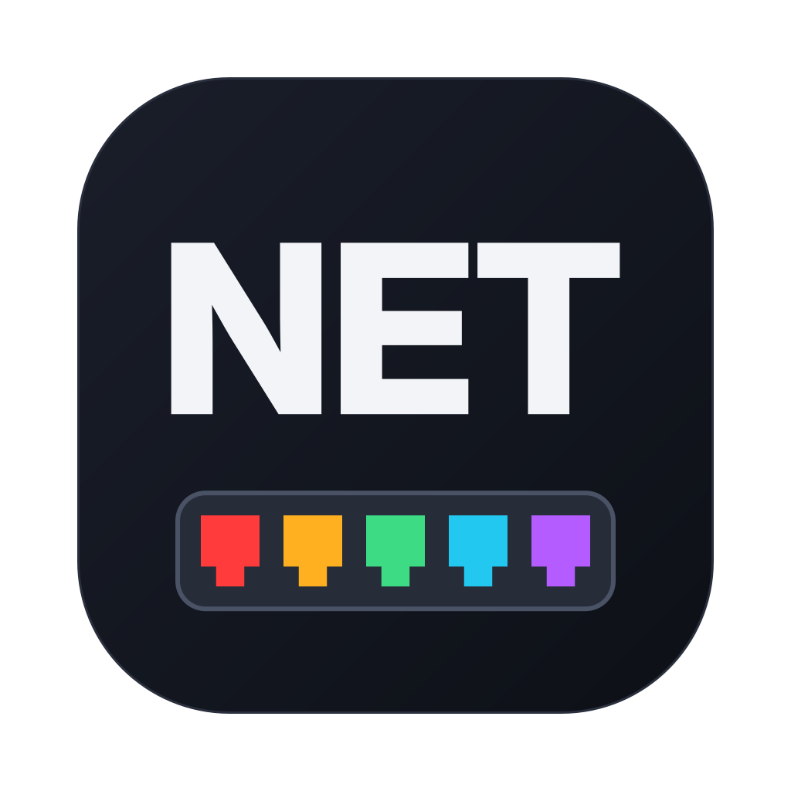 **NET Link** | Wer ist im Show-Netz? Findet IP-Konflikte, falsche Subnetze und fehlendes Multicast | kommt bald | – | – |
| 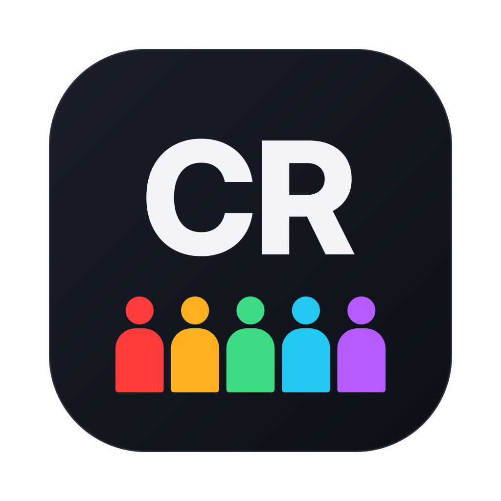 **Crew Link** | Timetable der Nacht: wer wann spielt, eine Uhr für alle | kommt bald | – | – |
| 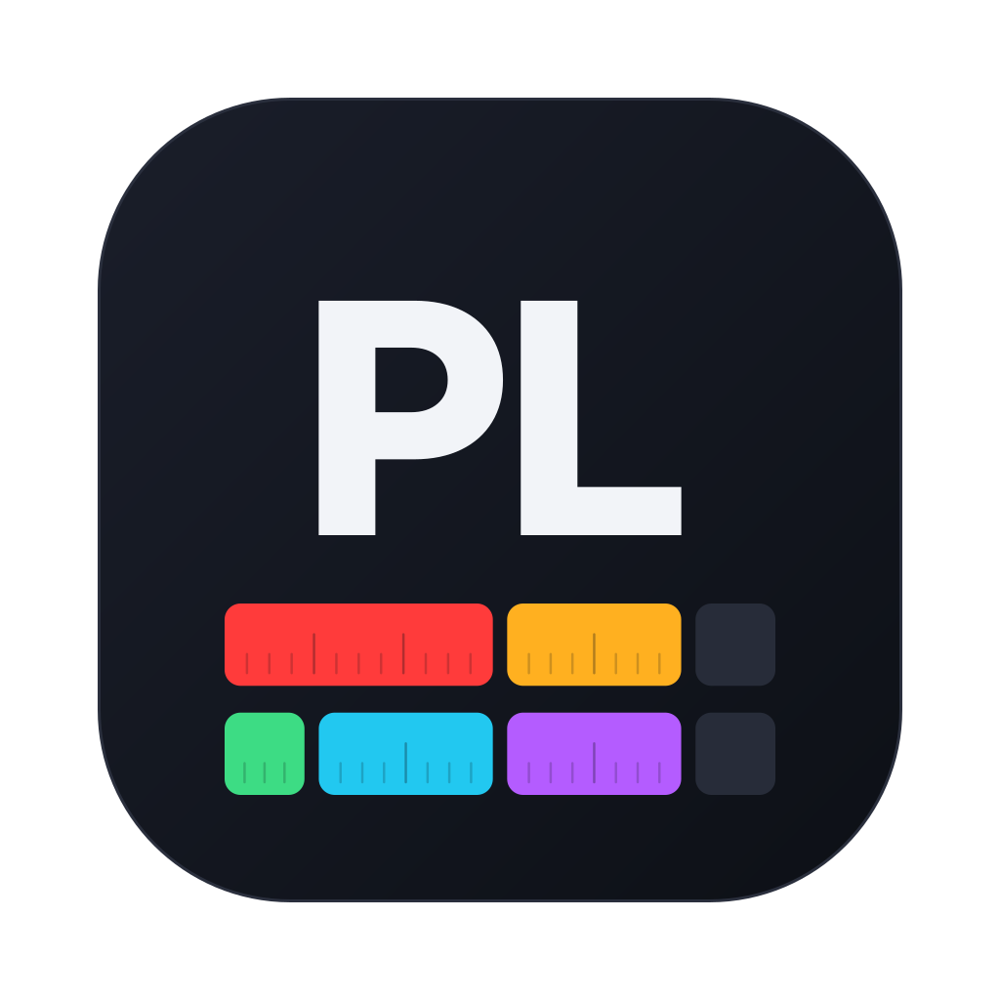 **PL Link** | Patch und Stromlast: DMX-Adressen, Stromkreise und Packlisten | kommt bald | – | – |
| 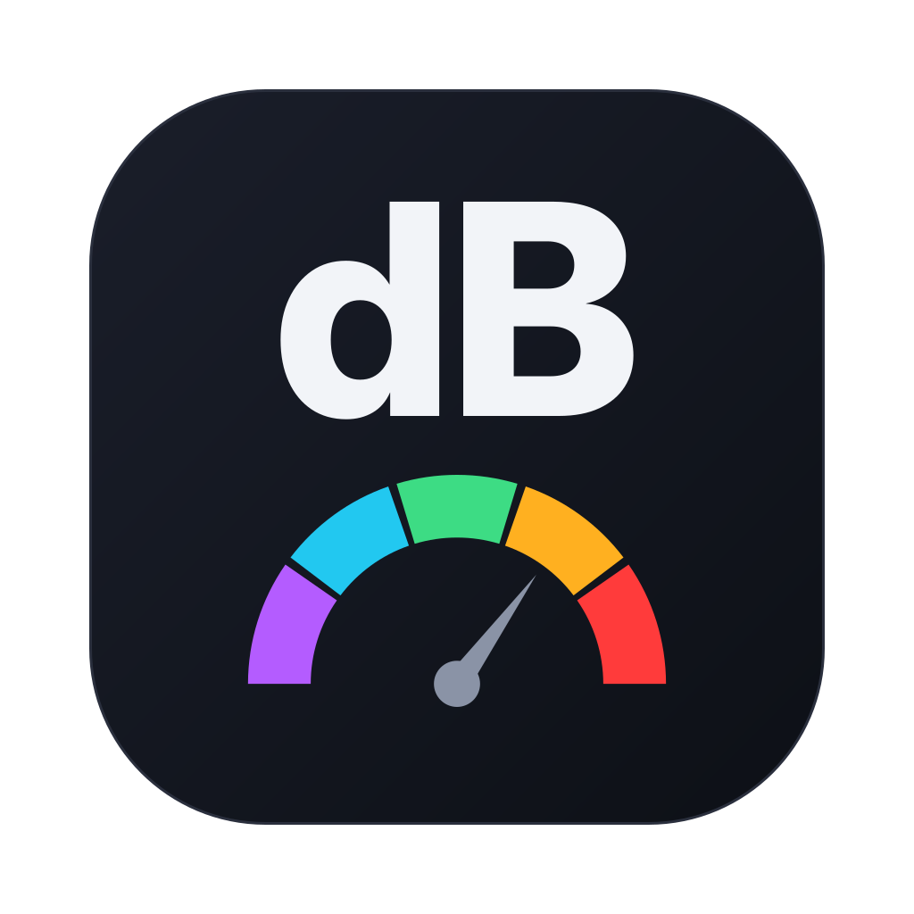 **dB Link** | Lautstärke nach DIN 15905-5: messen, warnen, protokollieren | kommt bald | – | – |

Für die Programme, die bald kommen, gibt es keine Termine.

## So funktioniert's

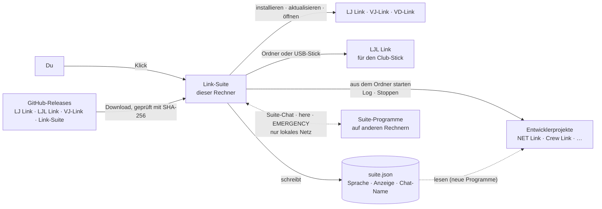

Ins Internet gehen nur die Frage nach neuen Versionen und die Downloads, und nur zu GitHub. Alles andere bleibt auf diesem
Rechner und im lokalen Netz.

### So wird ein Download geprüft

1. Link-Suite fragt GitHub nach dem neuesten Release des Programms und wählt die Datei für dein System und deinen Chip.
2. Es lädt nur von GitHub-Adressen, die zum Repository dieses Programms gehören.
3. Nach dem Download muss die Größe stimmen, und **Link-Suite prüft jede Datei mit SHA-256 gegen die Prüfsumme, die GitHub
   zum Release angibt.** Fehlt die Prüfsumme in einem Release, installiert Link-Suite nichts und öffnet nur die Seite.
4. **Eine eigene Signatur der Suite kommt später** (`SHA256SUMS` mit `SHA256SUMS.sig`). Hat ein Release schon eine, prüft
   Link-Suite sie bereits heute. Eine falsche Signatur stoppt die Installation.
5. Der Inhalt muss passen: auf dem Mac genau eine App, das richtige Programm in der richtigen Version; ein Zip darf nicht aus
   seinem Ordner heraus zeigen. Erst dann wird die alte Version ersetzt. Klappt das Ersetzen nicht, kommt die alte zurück.
6. Ein Programm, das noch läuft, ersetzt Link-Suite nicht und beendet es auch nicht. Es bittet dich, das Programm zu beenden.
   Kommen 60 Sekunden lang keine Daten, bricht der Download ab, und nichts wird ersetzt.
7. Unter Windows startet Link-Suite den Installer des Programms, und du klickst ihn durch.

Die SHA-256-Prüfung schützt vor kaputten und vertauschten Downloads, **aber nicht vor einem übernommenen GitHub-Konto**: Wer
das Konto hat, könnte eine andere Datei mit passender Prüfsumme veröffentlichen. Dafür ist die Signatur der Suite da, sobald
es sie gibt. Eine Signatur von Apple oder Microsoft ersetzen die Prüfungen auch nicht.

## Was deinen Rechner verlässt

Link-Suite sendet ins lokale Netz, solange der Suite-Chat an ist (ab Werk an, ausschalten unter *Einstellungen →
Suite-Chat*), und fragt GitHub nach Releases.

| Daten | Wer sie bekommt |
|---|---|
| „Ich bin da“ alle 5 Sekunden: Programmname *Link-Suite*, Version, dein Name und Platz aus den Einstellungen (wenn gesetzt), eine Zufallskennung | jedes Suite-Programm im lokalen Netz (Multicast `239.255.76.76:47676`) |
| Chat-Nachrichten und EMERGENCY, die du sendest | jedes Suite-Programm im lokalen Netz |
| Antwort auf die Netzprüfung von NET Link (`echo`), mit der IPv4-Adresse jedes Netzwerkadapters | das NET Link, das gefragt hat |
| „Tschüss“ beim Beenden | jedes Suite-Programm im lokalen Netz |
| Die Frage nach den neuesten Releases der Suite-Programme und die Downloads, die du startest | GitHub (`api.github.com`, `github.com` und die Download-Server von GitHub). Wie jede Website sieht GitHub deine IP-Adresse. Kein Name, keine Liste deiner Programme wird gesendet |
| Liste deiner installierten Programme, deine Ordner, das Log von Entwicklerprojekten | nie – bleibt auf diesem Rechner |
| Nutzungsdaten, Absturzberichte, Telemetrie | gibt es nicht |

Der Chat ist **unverschlüsselt**. Jeder im selben Netzwerk kann mitlesen, und die Programme im Raum behalten die letzten
Nachrichten und geben bis zu 20 an Neue weiter. Schreib nichts Vertrauliches. Nachrichten liegen nur im Arbeitsspeicher, nie
in einer Datei oder einem Log.

Ein Entwicklerprojekt, das du startest, ist ein eigenes Programm. Was es tut, auch wenn `npm` Pakete aus dem Internet lädt,
legt das Projekt fest, nicht Link-Suite. Deshalb fragt Link-Suite vorher.

## Was es nicht tut

- Es steuert kein Gerät, kein Lichtpult und kein anderes Programm im Netz.
- Es fasst keine anderen Rechner an. IM NETZ zeigt sie nur.
- Es installiert nichts ohne deinen Klick, und nur aus den GitHub-Releases der Suite.
- Es ändert nichts von selbst in Projektordnern: kein `npm install`, kein Build, kein git.
- Es schaltet Gatekeeper und SmartScreen nicht ab und ändert keine Systemeinstellung.
- Es braucht keine Admin-Rechte und fragt nach keinem Passwort. Ohne Admin-Rechte landen Programme in `~/Applications`.

## Stand der Version 0.3.2

### Was neu ist in 0.3

| Bereich | Stand |
|---|---|
| Oberfläche | oben die Kennzahlen Update, läuft, installiert und Entwicklung; Programme in Gruppen (installiert, Entwicklung, verfügbar, kommt bald); eine Pille je Karte |
| Startanimation | die Programme fliegen in ihre Karten; überspringbar, ruhig bei „Bewegung reduzieren“, abschaltbar |
| Mac-Feinschliff | Fenster ohne Titelleiste, Menüs mit Tastenkürzeln, Über-Fenster, Dock-Fortschritt und -Badge, stille Mitteilungen, Menüleisten-Symbol, Willkommen-Karte, DMG-Fenster |
| Updates | dasselbe Programm mehrmals hintereinander aktualisieren klappt sauber; ein Download bricht nach 60 Sekunden ohne Daten ab, nicht nach einer festen Gesamtzeit |
| Entwickleransicht | nur mit Entwicklerordnern; ohne sie ab Werk aus |
| Windows (0.3.2) | Installer pro Benutzer, Deutsch/Englisch, ohne Admin-Rechte; Updates von Programmen, die Admin-Rechte brauchen, öffnen ihren Installer mit der Windows-Abfrage. Firewall-Regeln, die Windows beim ersten Start anlegt, bleiben nach dem Deinstallieren stehen |

### Was es kann

| Bereich | Stand |
|---|---|
| Nach Releases fragen | fragt GitHub beim Start und auf Knopfdruck; die Prüfung beim Start ist abschaltbar |
| Installieren und Aktualisieren | LJ Link und VJ-Link aus ihren GitHub-Releases |
| LJL Link | *Auf den Stick*: in einen Ordner oder direkt auf den USB-Stick des Clubs, mit kurzer Anleitung; `club.json` weiter von Hand |
| Selbst-Update | aus [seinen eigenen Releases](https://github.com/skyplayser/Link-Suite/releases) (`skyplayser/Link-Suite`); die geprüfte neue Version wird beim Beenden eingesetzt |
| VD-Link | „bald verfügbar“ |
| Programme starten | installierte Apps, und Entwicklerprojekte mit Log-Leiste, wenn die Entwickleransicht an ist |
| Suite-Chat, IM NETZ, gemeinsame Einstellungen | wie in 0.1 |

### Noch offen

| Geplant | Wann |
|---|---|
| Eigene Signatur der Suite an jedem Release (`SHA256SUMS.sig`), dann Pflicht für jede Installation | später |
| VD-Link über Link-Suite | sobald seine Releases öffentlich sind |
| *Club-Stick vorbereiten* mit `club.json` für LJL Link | später |
| Bonjour: Weboberflächen der Suite-Programme finden, *Im Browser öffnen* | später |
| Installer mit Signatur von Apple und Microsoft, von Apple notarisiert | später |
| *Problem melden* in Link-Suite | noch nicht |

### Was geprüft ist

Aus der QA von 0.3 und 0.3.1. **Ergebnis für macOS: release-fertig.**

- **Bauen und Tests:** `npm run check` mit 146 Unit-Tests ist grün; `npm run dist:mac` baut beide DMGs.
- **Installieren und Aktualisieren, echt:** VJ-Link aus GitHub installiert, dann zweimal hintereinander aktualisiert – jedes
  Mal sauber, ohne Reste, kein eingehängtes Image. Ein abgebrochener Download lässt die installierte App unverändert. Das
  lief in einem Entwickler-Build mit demselben Code, weil sich die fertige App (mit Absicht) nicht fernsteuern lässt.
- **Langsame Downloads:** gegen einen gedrosselten lokalen Server geprüft, in Node und unter Electron. Einen gedrosselten
  echten GitHub-Download konnten wir nicht prüfen.
- **Oberfläche:** alle Tabs in Tag und Nacht, Deutsch und Englisch, in vier Fenstergrößen; die Startanimation gemessen und
  Bild für Bild geprüft.
- **Fertige App:** mit echten Daten gestartet und Screenshots aufgenommen; die installierten Programme und die Kennzahlen
  stimmten.
- **Sicherheit:** Download-Allowlist, Preload, Über-Fenster, Log ohne Benutzerpfade; aus 0.1 und 0.2: Fuzzing der
  Netz-Nachrichten und Prüfung der Electron-Einstellungen.
- **Nur im Code, nicht live:** Dock-Fortschritt und Mitteilungen, das DMG-Fenster im Finder, der helle Systemmodus beim Start.
- **Nicht geprüft:** das Selbst-Update (es gab noch kein Release von Link-Suite), Link-Suite zwischen zwei echten Rechnern
  oder im Club.
<!-- WINDOWS-STAND (geprüft). Aktiv: Fassung A. Zum Umschalten Zeile A löschen und Zeile B aus dem Kommentar holen. -->
- **Windows:** noch nicht getestet.
<!-- B: - **Windows:** getestet auf Windows 11 . -->

## Herunterladen und installieren

Lade Link-Suite für deinen Rechner. Die Dateien kommen direkt aus dem [neuesten Release](https://github.com/skyplayser/Link-Suite/releases/latest); alle
Versionen und Änderungen stehen auf der [Release-Seite](https://github.com/skyplayser/Link-Suite/releases).

<!-- WINDOWS-STAND (Download-Tabelle). Aktiv: Fassung A. Zum Umschalten Zeile A und den Absatz A unten löschen
     und Zeile B aus dem Kommentar holen. -->
| System | Datei | Stand |
|---|---|---|
| macOS 13 oder neuer, Apple-Chip (M1 und neuer) | [`Link-Suite-macos-arm64.dmg`](https://github.com/skyplayser/Link-Suite/releases/latest/download/Link-Suite-macos-arm64.dmg) | Alpha |
| macOS 13 oder neuer, Intel | [`Link-Suite-macos-intel.dmg`](https://github.com/skyplayser/Link-Suite/releases/latest/download/Link-Suite-macos-intel.dmg) | Alpha |
| Windows 10 / 11, 64 Bit | [`Link-Suite-windows.exe`](https://github.com/skyplayser/Link-Suite/releases/latest/download/Link-Suite-windows.exe) | **Alpha, ungetestet** |
<!-- B: | Windows 10 / 11, 64 Bit | [`Link-Suite-windows.exe`](https://github.com/skyplayser/Link-Suite/releases/latest/download/Link-Suite-windows.exe) | Alpha, getestet auf Windows 11 | -->

<!-- A (löschen, sobald Windows getestet ist): -->
**Unter Windows** kannst du die Programme weiter direkt aus ihren eigenen Releases laden, solange die Windows-Version von
Link-Suite ungetestet ist: [LJ Link](https://github.com/skyplayser/LJ-Link/releases/latest) ·
[VJ-Link](https://github.com/skyplayser/VJ-LINK/releases/latest).

Die Einzel-Downloads der Programme bleiben auch in ihren GitHub-Releases. Dann Link-Suite öffnen, **PROGRAMME** wählen und
beim gewünschten Programm auf **Installieren** drücken.

### Erster Start: die Warnung überspringen

Link-Suite ist **nicht bei Apple oder Microsoft signiert** (auf dem Mac ad-hoc signiert, nicht notarisiert). Eine Signatur
kostet Geld und sagt nichts über die Sicherheit aus. Aber beide Systeme warnen deshalb einmal beim ersten Start. Lade
Link-Suite nur von dieser GitHub-Seite oder von [der Website](https://skyplayser.github.io/Link-Suite/de/).

**macOS** („Link-Suite“ nicht geöffnet – Apple konnte nicht überprüfen, ob „Link-Suite“ frei von Schadsoftware ist):

1. Die `.dmg` öffnen und Link-Suite auf *Programme* ziehen.
2. Link-Suite einmal starten. Bei der Warnung auf *Fertig* klicken (nicht *In den Papierkorb legen*).
3. *Systemeinstellungen → Datenschutz & Sicherheit* öffnen und ganz nach unten scrollen.
4. Bei „Link-Suite wurde blockiert …“ auf **Dennoch öffnen** klicken, mit Passwort oder Touch ID bestätigen, dann *Öffnen*.
5. **Lokales Netzwerk erlauben**, wenn macOS fragt. Link-Suite braucht es für den Suite-Chat und IM NETZ. Verpasst?
   *Systemeinstellungen → Datenschutz & Sicherheit → Lokales Netzwerk*.

**Nach einem Update kann macOS erneut nach dem lokalen Netzwerk fragen.** Die App ist nicht signiert, deshalb hält macOS die
neue Version für eine neue App. Erlaube es dann noch einmal.

Auf macOS 14 und älter geht auch: Rechtsklick auf die App → *Öffnen* → *Öffnen*. Per Terminal:
`xattr -dr com.apple.quarantine "/Applications/Link-Suite.app"`. Das schaltet die Download-Prüfung von macOS für diese App
ab. Nutze es nur für eine Kopie von dieser GitHub-Seite oder der offiziellen Website.

**Windows** („Der Computer wurde durch Windows geschützt“, Microsoft Defender SmartScreen):

1. `Link-Suite-windows.exe` starten.
2. Im blauen Fenster auf **Weitere Informationen** klicken, dann auf **Trotzdem ausführen**.
3. Den Installer durchklicken. Er installiert nur für deinen Benutzer und braucht keine Admin-Rechte.
4. Fragt die Windows-Firewall: *Private Netzwerke* anhaken und *Zugriff zulassen* (für den Suite-Chat).

Manche Virenscanner melden unbekannte, unsignierte Programme vorsorglich. Lade die Datei im Zweifel direkt von GitHub.

**Die Programme, die Link-Suite installiert,** schreibt Link-Suite selbst auf die Platte – so wie die eingebauten Updater
von LJ Link und VJ-Link. macOS prüft sie dann nicht selbst. Link-Suite prüft vorher jede Datei mit SHA-256 (siehe
[So wird ein Download geprüft](#so-wird-ein-download-geprüft)); bei Apple oder Microsoft signiert sind auch die Programme nicht.

## Schnellstart

1. Link-Suite starten. Die Startanimation zeigt die Suite, darunter baut sich die Programmliste auf.
2. **PROGRAMME:** bei einem Programm, das dir noch fehlt, **Installieren** drücken, bei einer neuen Version
   **Aktualisieren**, bei einem installierten **Starten**. Ist die Entwickleransicht an, startet
   **Starten (Entwickler)** ein Projekt aus seinem Ordner; unten öffnet sich die Log-Leiste.
3. **LJL Link:** auf seiner Karte **Auf den Stick** wählen und einen Ordner oder den USB-Stick des Clubs angeben.
   Die `club.json` des Clubs neben die App legen, wie im [LJL-Link-README](https://github.com/skyplayser/LJL-Link/blob/main/README.de.md) beschrieben.
4. **IM NETZ:** sehen, welche Suite-Programme auf welchem Rechner laufen.
5. **EINSTELLUNGEN:** Name und Platz für den Chat (zum Beispiel „Max“ und „Booth“), Sprache und Tag oder Nacht einstellen.
6. Chat: die Sprechblase oben rechts. **EMERGENCY** ist der gelbe Knopf.

> [!IMPORTANT]
> EMERGENCY ist ein Hinweis-Popup fürs Team, keine Alarm- oder Sicherheitsanlage. Es ist eine Alpha, kann ausfallen oder
> verspätet ankommen, und jeder im selben Netzwerk kann es auslösen. Es ersetzt keine Durchsagen, Funkgeräte oder das
> Sicherheitskonzept der Veranstaltung.

## Probleme?

Link-Suite hat noch kein eigenes *Problem melden*. Sag uns Bescheid auf [Discord](https://discord.gg/N6DMca4Bjk) oder per
Mail an fehlermelden@nextphilm.de: was du gemacht hast, was passiert ist, die Version von Link-Suite und dein System (macOS
oder Windows, mit Version). Das Log eines Entwicklerprojekts schick nur mit, wenn nichts Privates drinsteht.

Bricht eine Installation oder ein Update ab? Link-Suite sagt, warum (zum Beispiel „Prüfsumme falsch. Die Datei wurde
gelöscht, nichts wurde ersetzt.“). Du kannst immer **Seite öffnen** wählen und das Programm aus seinem GitHub-Release laden.

Probleme im Netz? Dafür ist NET Link da. Es ist in Entwicklung; bis dahin sagt das die Fußzeile von Link-Suite.

---

## Für Entwickler

Version **0.3.2**: alles aus 0.1 und 0.2 (Programmliste, installierte Apps und Entwicklerprojekte starten, Suite-Chat
mit EMERGENCY, IM NETZ, Installieren und Aktualisieren aus GitHub, Club-Stick, Selbst-Update), dazu die neue Oberfläche,
die Startanimation mit Launcher-Ende, der macOS-Feinschliff und der Windows-Installer pro Benutzer.
Konzept, Recherche, Design und QA-Berichte liegen außerhalb dieses Repos. Release-Notizen: [`docs/releases/`](docs/releases/).

### Voraussetzungen

Node.js 22+, macOS (Apple-Chip getestet). Windows: gebaut; der Test auf Windows 11 läuft noch.

### Befehle

| Befehl | Was |
|---|---|
| `npm install` | Abhängigkeiten (nur Bauwerkzeuge und Electron) |
| `npm run check` | Startanimation erzeugen, Typecheck, Tests (vitest) |
| `npm run build` | Startanimation-Modul, Hauptprozess/Preload (esbuild → `dist-electron/`), Oberfläche (Vite → `dist/`) |
| `npm start` | bauen und starten (echte Programme, echter Suite-Chat auf 47676) |
| `npm run demo` | bauen und im Demo-Modus starten |
| `npm run shots` | Screenshots aller Tabs im Demo-Modus nach `shots/` |
| `npm run dist:dir` | `release/mac-arm64/Link-Suite.app` (unsigniert, ad hoc `identity: "-"`) |
| `npm run dist:mac` | macOS mit Apple-Chip und Intel als `.dmg` |
| `npm run dist:win` | Windows `.exe` (NSIS) |
| `scripts/release.sh` | prüft, ob `docs/releases/v0.3.2.md` da ist, gibt lokale Prüfsummen zum Testen und den Tag-Befehl aus; veröffentlicht nichts |
| `.github/workflows/release.yml` | der einzige Weg zu veröffentlichen: ein Tag `v*` baut alle drei Pakete, schreibt `SHA256SUMS` und legt das Release mit dem Text aus `docs/releases/<tag>.md` an |

Nach `/Applications` kopieren machst du selbst: `ditto release/mac-arm64/Link-Suite.app /Applications/Link-Suite.app`.

### Demo-Modus und Screenshots

`electron . --demo` legt unter `$TMPDIR/link-suite-demo-*` Testordner an: zwei „installierte“ Apps (nur `Info.plist`),
sechs Entwicklerprojekte in allen Zuständen (VJ-Link gebaut → Direktstart eines Demo-„Electron“ (Shell-Skript), VD-Link
nicht gebaut → `npm run dev` nach Rückfrage, NET Link ohne `package.json`, Crew Link ohne `node_modules`, dB Link
ohne Skript, PL Link ohne Ordner). Erfundene Teilnehmer im Netz kommen über denselben Weg wie echte Datagramme
(`ChatNet.inject`). Chat auf Testport 47684, eigener Datenordner im Temp (die echte `suite.json` bleibt unberührt).
Beim Beenden wird der eigene Demo-Ordner gelöscht.

Screenshot für die QA: rendern, `capturePage()`, beenden.

```
npx electron . --demo --shot=shots/programme.png --tab=programs --theme=dark --lang=de
```

| Schalter | Werte |
|---|---|
| `--shot=<datei.png>` | Ziel (Fenster 1480 × 920) |
| `--tab=` | `programs` · `network` · `stick` · `settings` |
| `--theme=` / `--lang=` | `light`/`dark` · `de`/`en` |
| `--open=<id>` | Detailspalte für ein Programm (`lj`, `vj`, `vd`, `ljl`, `net`, `crew`, `pl`, `db`) |
| `--run=<id>` | Entwicklerprojekt starten, Log-Leiste zeigen |
| `--menu=<id>` · `--chat` | ⋯-Menü offen · Chat-Panel offen |
| `--intro=<ms>` | Startanimation zeigen und nach so vielen ms aufnehmen (z. B. 1200) |

Die Bilder in `docs/assets/shots/` sind so mit `TMPDIR=/tmp` entstanden, damit keine persönlichen Pfade zu sehen sind; bei
IM NETZ wurden Name und Adressen des Rechners danach unkenntlich gemacht.

Ohne `--demo` zeigt `--shot` die echten Programme dieses Rechners (Daten ebenfalls nur im Temp, Chat auf dem Testport).

### Aufbau

```
src/core/       reine Logik, ohne Electron, voll getestet
  catalog.ts    die acht Programme (Kennungen, App-Namen, Entwicklerordner, Einzeiler)
  release.ts    Installieren und Aktualisieren: Quellen je Programm, GitHub-digest, SHA256SUMS und Signatur,
                erlaubte Hosts, Größe, Zip- und Bundle-Prüfung
  devproject.ts Startbarkeit eines Entwicklerprojekts (package.json, node_modules/electron/path.txt, Build)
  plist.ts      Auswertung von plutil -convert json
  procs.ts      ps -axo pid=,comm= → Apps und Entwicklerstarts
  env.ts        Umgebung säubern, Login-Shell mit Marker, PATH
  ringlog.ts    Log-Ringpuffer (5000 Zeilen), Zeilen, ANSI weg
  finder.ts     Spotlight-Filter, bester Treffer, Registry (Windows)
  settings.ts   suite.json / launcher.json
  suitechat.ts  Chat-Raum (aus VJ-Link)
  suitenet.ts   Liste „Im Netz“, probe/echo
  i18n.ts       Texte DE/EN
src/main/       Hauptprozess (esbuild)
  main.ts       Fenster, IPC (nur Kennungen), Demo, Screenshots, Menüleiste, Beenden-Rückfrage
  apps.ts       finden (/Applications, ~/Applications, mdfind, /Volumes für LJL Link), open -a
  devrun.ts     Entwicklerstarts: spawn detached, Log, SIGTERM an die Gruppe, nach 5 s SIGKILL
  suitechat.ts  Chat-Sockets (aus VJ-Link) + Roster + echo
  store.ts      Einstellungen auf der Platte (atomar)
  demo.ts       Demo-Testordner und erfundene Teilnehmer
  preload.ts    schmale Brücke window.suite
src/renderer/   Oberfläche (Vite), launcher.css aus design/, intro/ erzeugt aus vendor/startanimation
tests/          vitest
```

Einstellungen: `~/Library/Application Support/Link-Suite/suite.json` (für alle Suite-Programme: Sprache, Anzeige, Chat,
Startanimation) und `launcher.json` (Entwicklerordner als `~/…` oder absolut, Startweg je Programm, Hintergrund).

Ports: Suite-Chat 47676 mit `reuseAddr` (Geschwister laufen weiter). Tests: `LINKSUITE_TEST_PORT` (Standard 47683),
Demo/Screenshots 47684, sonst `LINKSUITE_CHAT_PORT`. `LINKSUITE_INSTALL_DIR=<Ordner>` legt nur für Tests das
Installationsziel fest; `LINKSUITE_USER_DATA=<Ordner>` nutzt einen eigenen Datenordner. `LINKSUITE_OFFLINE=1` (nur
Entwickler-Build oder Demo) tut so, als sei GitHub nicht erreichbar; `LINKSUITE_WELCOME=1` zeigt im Demo und bei Screenshots
die Willkommen-Karte. Im Demo beantwortet der Launcher kein `probe` (ein Demo-Netz sendet
weder `probe` noch `echo`).

**Offen (QA 0.1, Befund 6):** Die Testports 47683 (Tests) und 47684 (Demo/Screenshots) stehen noch nicht im
Testport-Register von `suite-net/spec/suite-net.md`. Bitte dort eintragen (Repo `suite-net`, nicht Teil dieses Projekts).

Gepackte App: Electron-Fuses über `build.electronFuses` (electron-builder): RunAsNode, `NODE_OPTIONS` und
`--inspect` aus, OnlyLoadAppFromAsar und die eingebettete Asar-Prüfung an.

### Website

Die Website unter [skyplayser.github.io/Link-Suite](https://skyplayser.github.io/Link-Suite/de/) ist einfaches HTML in
[`docs/`](docs/) für GitHub Pages: `docs/index.html` (Englisch), `docs/de/index.html` (Deutsch), `docs/assets/` (CSS,
Skript, Logos, Screenshots). Kein Build-Schritt, keine Tracker, keine externen Schriften oder CDNs.

## Danksagung und Hinweise

Gebaut mit [Electron](https://www.electronjs.org/) (MIT). Der Code des Suite-Chats und Teile der Update-Logik stammen aus
VJ-Link (EPL-2.0); Einzelheiten in [THIRD_PARTY.md](THIRD_PARTY.md). Schriftzug im Logo: [Inter](https://github.com/rsms/inter)
(SIL Open Font License 1.1), als Pfade in den SVGs, keine Schriftsoftware enthalten.

Link-Suite ist ein unabhängiges Projekt und kein offizielles Produkt von Apple, Microsoft, GitHub, AlphaTheta / Pioneer DJ,
inMusic / Denon DJ, Serato, MA Lighting oder anderen hier genannten Herstellern; es wird von ihnen weder unterstützt noch
geprüft. Alle Produktnamen und Marken gehören ihren Inhabern und werden nur genannt, um die Kompatibilität zu beschreiben.
Art-Net™ Designed by and Copyright Artistic Licence Holdings Ltd. Die Link-Suite hat nichts mit der Software LightJockey von
Martin zu tun.

Link-Suite ist kostenlos und ohne Gewähr. Software, Netz und Geräte können ausfallen: Halte immer einen Plan B bereit.

## Lizenz

© 2026 Philipp Spruck / NEXTPHILM. Link-Suite steht unter der [Eclipse Public License 2.0](LICENSE) und wird ohne jede
Gewährleistung bereitgestellt.

<br>

<p align="center">
  <sub>Idee SKYPLAYSER/NEXTPHILM<br>
  Prompted with ❤️ made by Claude<br>
  <a href="https://skyplayser.github.io/VJ-LINK/impressum.html">Impressum</a> ·
  <a href="https://skyplayser.github.io/VJ-LINK/datenschutz.html">Datenschutz</a></sub>
</p>
